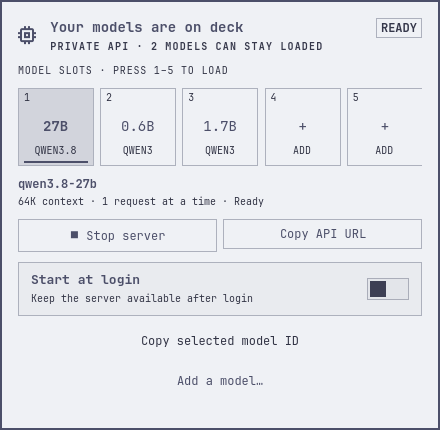

# Omarchy AI Model Dock

Run local AI models on your Omarchy machine and use them from an agent, an app
or another computer.

Model Dock gives you a native model hotbar, a private inference endpoint and a
small CLI. A bundled agent skill helps inspect the hardware, prepare a model
and measure how it behaves on your machine.



Native Omarchy controls, shown with example model slots.

## Install

```bash
omarchy plugin add https://github.com/gustavonline/omarchy-ai-model-dock --enable --yes
```

Open **Model Dock** on the right side of the bar and choose **Set up Model Dock**.
The short terminal setup can download a small starter, prepare the runtime and
check the endpoint. You can also ask your agent to read [SKILL.md](SKILL.md) and
configure a model for your work.

A compatible `llama-server` is reused. If one is missing, the CLI can build a
pinned version; missing system build/driver packages need the owner's ordinary
package-install access. See the [setup guide](SETUP.md).

## Use it

The numbered slots hold prepared models. Click a slot or press **1–5** while
the panel is open to load one. Empty slots open setup. The panel shows the
selected model, context and availability, with controls to start/stop the server
and copy the API URL or model ID.

Agents use the same backend:

```bash
omarchy-model-dock inspect
omarchy-model-dock start
omarchy-model-dock load qwen3-1.7b
omarchy-model-dock client pi --model qwen3-1.7b
```

Model names in examples are small setup probes. Ask an agent to choose and test
a model against your actual task and available memory.

## What it provides

- OS, memory and actual accelerator inspection.
- Pinned, SHA-256-verified GGUF downloads.
- A systemd user service with llama.cpp's model router.
- Multiple model IDs, on-demand loading and a chosen resident-model limit.
- Per-model context, parallel requests, prompt/KV caching and optional MTP.
- A loopback API with a private key; SSH access from other networks.
- Separate Pi/Codex client profiles and a discoverable agent skill.

The endpoint can be used by a Python service or a compatible client. Agent
protocol support and model quality need to be verified with that client. See
[client connections](docs/CLIENTS.md).

## Hardware and scope

The serving workflow has been tested on **AMD Strix Halo / Radeon 8060S with
Vulkan on Linux**, including Qwen 3.8 27B at 64K and real Pi coding work. A CPU
build was also tested. Hardware detection does not establish equal performance
on other machines; [Mac Studio/MLX remains open](https://github.com/gustavonline/omarchy-ai-model-dock/issues/13).

Model Dock manages local inference on one machine. Trusted users can connect
through SSH. A public multi-tenant API, cluster load balancing and desktop
observation are outside the product's current scope.

## Updating from Local AI

The repository is now `omarchy-ai-model-dock`. GitHub redirects the old URL.
The internal plugin ID remains `io.github.gustavonline.local-ai`, so existing
bar placement and installations keep working. The CLI remains
`omarchy-model-dock`.

Version 0.12 removes the former always-on assistant, voice/suggestion UI,
desktop observer and harness delegation. The migration command retires its
owned service and push-to-talk bindings with a backup:

```bash
omarchy-model-dock migrate
```

Private settings/history, model weights, API keys and existing runtime profiles
are retained. Existing profiles are still available in the panel. Read
[migration and recovery](docs/MIGRATING.md) before upgrading an active assistant.

## Documentation

- [Setup, runtime lifecycle and tuning](SETUP.md)
- [Agent skill](SKILL.md)
- [Private and remote client connections](docs/CLIENTS.md)
- [Qwen 3.8 27B / 64K test record](docs/QWEN38-Z13.md)
- [Initial Z13 validation](docs/Z13-VALIDATION.md)
- [Release checks](RELEASING.md)

Measurements are kept as dated evidence with their hardware, task and limits.
They are not a ranking of every model or a promise about another machine.

```bash
./test.sh
```

Settings, models and keys live outside the checkout. The plugin uses Omarchy's
native shell components and theme tokens without changing system shell files.
MIT licensed; see [LICENSE](LICENSE).
